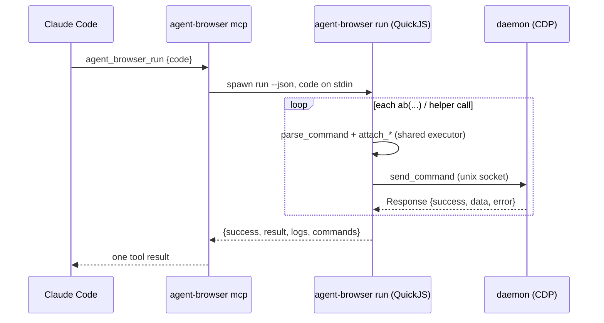

# feat: Code mode (`run`), site skills, and snapshot redaction

**Target repo:** agent-browser-plus (fork of vercel-labs/agent-browser), branch `feat/code-mode-site-skills`

---

## Goal Capsule

**Objective:** Make an AI coding agent (Claude Code first) finish multi-step browser tasks in far fewer model turns. Add a sandboxed JavaScript "code mode" (`agent-browser run`, MCP `agent_browser_run`) that can call every existing CLI command with loops, conditionals and data flow in one invocation. Add site skills for GitHub, Gmail, Google Workspace and LinkedIn that ship JavaScript helpers for that sandbox. Redact secrets from snapshots.

**Authority:** This plan, then `AGENTS.md` (CLI/MCP parity, docs locations, no emojis, kebab-case flags), then existing code conventions.

**Stop conditions:** Surface a blocker instead of guessing if `rquickjs` cannot build for a released target, or if parity tests require changing upstream MCP behaviour for existing tools.

---

## Product Contract

### Problem

Every browser step in agent-browser costs one agent turn: the model reasons, emits one CLI call, then reads the output. `batch` removes process start-up overhead but is a fixed list, so it can't branch on page state, loop over results or pass a value from one command into the next. Wall-clock time in agent workflows is dominated by turns, not by CDP latency.

### Requirements

- **R1** `agent-browser run` executes JavaScript from a file argument, `-e <code>` or stdin. Inside, `ab(...args)` runs any CLI command (same grammar as the command line) and returns its JSON `data`. Failures throw a JS `Error` carrying the command's error message and code.
- **R2** Ergonomic helpers over `ab`: `open`, `snapshot`, `click`, `fill`, `type`, `press`, `text`, `get`, `wait`, `evalPage` (page-side JS), `screenshot`, plus `console.log/info/warn/error` capture and `sleep`.
- **R3** The script's result is the value it `return`s, or the last `result(value)` call, and is emitted with the logs as JSON with `--json`.
- **R4** Sandbox: no filesystem, network, process or module access beyond `ab` and declared helpers. A wall-clock timeout (default 120 s, `--timeout`) and a memory cap apply. An infinite loop is interrupted cleanly.
- **R5** Cross-run memory: `store.get/set/delete/keys` persists JSON values per session between `run` invocations, since each run gets a fresh JS scope.
- **R6** `skills.load(name)` evaluates `skill-data/<name>/helpers.js` into the scope and returns its exported API (for example `const gh = skills.load('github')`). Loading a skill without helpers throws a clear error.
- **R7** MCP tool `agent_browser_run` (`code`, `timeoutMs`, `session` and the other common args) has parity with the CLI and appears in an MCP tools profile.
- **R8** Site skills `github`, `gmail`, `google-workspace` (Docs, Sheets, Drive, Calendar) and `linkedin`. Each has a `SKILL.md` (triggers, auth guidance, examples in both `run` and plain CLI) and `helpers.js` built only on `ab` and helpers. Helpers prefer stable URLs, ARIA roles and site export endpoints over brittle CSS.
- **R9** Snapshot redaction is on by default: values of password, OTP/passcode, card and CVV fields, and OTP-like codes in text near keywords, render as `[redacted]`. `--no-redact` (CLI) and `noRedact` (MCP) disable it.
- **R10** A local benchmark (`benchmarks/code-mode/`) runs the same multi-step tasks as separate CLI calls and as one `run` script against a fixture page. It reports invocation count (a proxy for agent turns), output bytes (a proxy for tokens) and wall time.
- **R11** Documentation per `AGENTS.md`: `cli/src/output.rs` help, `README.md`, `skill-data/core/SKILL.md` plus a references page, `docs/content/docs/` MDX page, and a `CHANGELOG.md` entry.

### Acceptance Examples

- **AE1** `agent-browser run -e "await open('data:text/html,<a href=#>x</a>'); const s = await snapshot({interactive:true}); return s.refs"` prints the refs object in one invocation.
- **AE2** A script that loops `for (const ref of refs) { await click('@'+ref); ... }` completes as a single call; a thrown command error shows the failing command and stops the script with a non-zero exit.
- **AE3** `while(true){}` under `--timeout 2000` exits with a timeout error in about 2 s and the daemon stays healthy.
- **AE4** `store.set('k', {a:1})` in one run and `store.get('k')` in the next returns `{a:1}` for the same `--session`.
- **AE5** A snapshot of a page with `<input type=password value=hunter2>` and the text "Your code is 482913" shows neither secret unless `--no-redact` is passed.

### Scope Boundaries

**Non-goals:** a Playwright-compatible `page`/`locator` object model (helpers take CLI selector strings and refs); running Node or npm packages in the sandbox; a persistent JS heap across runs.

#### Deferred to Follow-Up Work

- An everyday-Chrome extension relay (drive the user's own Chrome via `chrome.debugger`, with an agent tab group and per-site approval). Existing `--auto-connect` and `--profile` cover logged-in browsing for now.
- A coordinate/visual fallback API (`cua`-style) beyond the existing `mouse` and `screenshot --annotate` commands.
- An LLM-in-the-loop turn benchmark (real model, real tasks), as distinct from the deterministic invocation benchmark in R10.

---

## Planning Contract

### Key Technical Decisions

- **KTD1: The JS engine runs in the CLI process, not the daemon.** `run` behaves like `batch`: each `ab()` call goes through `parse_command`, the same `attach_*` decorations and `send_command_with_respawn`. The daemon is untouched, so every command keeps its tested behaviour and its policy checks (allowed domains, confirmations). Embedding the engine in the daemon would mean holding `&mut DaemonState` across JS host calls inside the tokio runtime, adding unsafe aliasing and blocking-in-async for little gain, since local socket round trips take well under a millisecond. Trade-off: no persistent JS heap between runs, which R5's `store` covers.
- **KTD2: `rquickjs` with synchronous host functions.** QuickJS is small (well under 1 MB added), embeddable, and offers interrupt and memory limits. Host functions block on the socket call and return plain values; `await` on a non-promise works, so scripts can be written async-style and stay compatible if the bridge later becomes truly async. The script body is wrapped in an async function so top-level `await` and `return` work.
- **KTD3: Shared command executor.** Extract the per-command body of `run_batch` (`cli/src/main.rs`) into one function returning a structured result. `batch` and `run` then share decoration and respawn logic, which avoids a third copy.
- **KTD4: MCP delegates through the CLI.** Following the existing `run_cli` pattern in `cli/src/mcp.rs`, `agent_browser_run` spawns `agent-browser run --json` with the code on stdin and maps the JSON to tool content. This gives parity by construction.
- **KTD5: `store` lives in the session socket directory** as a single JSON file next to the daemon's per-session files (`connection::get_socket_dir`). Writes are atomic (temp file plus rename). The size is capped at 1 MB.
- **KTD6: Skills stay filesystem content.** `helpers.js` sits next to `SKILL.md` and is found through the existing `skills.rs` package-root resolution, so it ships in the npm package like current skills. Each helpers file is a script that assigns its API to a known global (`exports`), so no module loader is needed.
- **KTD7: Redaction happens in the Rust renderer** (`render_tree` in `cli/src/native/snapshot.rs`), so the CLI, MCP, `run` and diff output all get it. A field is a secret if its role is a textbox and its accessible name matches a sensitive pattern, or its DOM `type`/`autocomplete` marks it as password or OTP. Text nodes are scanned for OTP-like digit runs next to keywords. The option travels as a snapshot command flag, matching existing snapshot options.

### High-Level Technical Design



Directional shape of the in-sandbox API:

```text
ab(...argv) -> data | throws AbError{message, code, command}
open(url) | snapshot({interactive, compact, selector, depth, diff}) | click(sel) | fill(sel, text)
type(sel, text) | press(key) | text(sel) | get(kind, sel?) | wait(arg) | evalPage(js) | screenshot(path?)
store.get/set/delete/keys   skills.load(name) -> api   result(v)   sleep(ms)   console.*
```

### Assumptions

- `rquickjs` (0.9.x or newer) builds on the release targets used by CI (macOS arm64/x64, Linux arm64/x64, Windows x64). Its `cc` build uses the platform C toolchain already needed for other crates. If Windows fails, gate the feature behind a cargo feature that's on by default elsewhere and surface this as a blocker.
- Site helpers can't be verified against live accounts in CI. They're validated by syntax and load tests plus manual smoke runs, and each `SKILL.md` documents a fallback to snapshot plus refs when a selector drifts.

---

## Output Structure

```text
cli/src/run/            mod.rs (engine, sandbox, bridge), store.rs, prelude.js
skill-data/github/      SKILL.md, helpers.js, references/
skill-data/gmail/       SKILL.md, helpers.js
skill-data/google-workspace/  SKILL.md, helpers.js, references/{docs,sheets,drive,calendar}.md
skill-data/linkedin/    SKILL.md, helpers.js
skill-data/core/references/code-mode.md
benchmarks/code-mode/   README.md, fixture.html, bench.mjs
docs/content/docs/code-mode.mdx
```

---

## Implementation Units

### U1. Shared command executor

**Goal:** One function executes a parsed argv against the daemon with the same decoration as `batch`.
**Requirements:** R1 (foundation)
**Dependencies:** none
**Files:** `cli/src/main.rs` (modify `run_batch` to use it), new helper next to it, with tests in the existing `main.rs` test module.
**Approach:** Lift parse, `attach_input_mode`, the TLS read/close handling, `attach_plugins_to_command`, `attach_restore_config_to_command`, `attach_pin_tab_to_command` and `send_command_with_respawn` into a function returning a structured outcome (success, data, error, code, warning, or a parse error). `batch` output must stay byte-identical.
**Patterns to follow:** `run_batch` and `send_command_with_respawn` in `cli/src/main.rs`.
**Test scenarios:** a parse error for an unknown command is returned as an error outcome, not an exit; the `attach_*` decorations are applied (for example input mode is carried through, as in the existing test `input_mode_session_setting_preserves_command_override`); existing batch tests stay green.
**Verification:** `batch` behaviour is unchanged and the helper is callable without `exit()` side effects.

### U2. QuickJS sandbox engine and `run` command

**Goal:** `agent-browser run <file> | -e <code> | stdin` with the `ab` bridge, helpers, console capture, result and timeout.
**Requirements:** R1, R2, R3, R4
**Dependencies:** U1
**Files:** `cli/Cargo.toml` (add `rquickjs`), `cli/src/run/mod.rs`, `cli/src/run/prelude.js` (embedded with `include_str!`), `cli/src/commands.rs` (parse `run`), `cli/src/main.rs` (dispatch before daemon command send, like `batch`), `cli/src/run/tests.rs` or an inline test module.
**Approach:** Create a runtime with a memory limit and an interrupt handler checking a deadline. Install host functions: `__ab(argvJson) -> resultJson`, `__log(level, text)`, `__store_*` and `__skill_source(name)`. Everything else is JS in `prelude.js`. Wrap user code as `(async () => { <code> })()` and drive pending jobs until the promise settles or the deadline passes. Remove `eval`/`Function`-style escape hatches only where they could reach host APIs; QuickJS has no fs/net, so the host-function surface is the boundary. Output: plain mode prints logs then the result (pretty JSON). `--json` prints `{success, result, logs, commands, error}`. Exit is non-zero on a thrown error or timeout. Record the per-command count in `commands`.
**Execution note:** Start with failing unit tests for the engine (result, throw, timeout) that use a stubbed bridge before wiring the real executor.
**Patterns to follow:** `run_batch` JSON output shape; `print_json_error`; `color::error_indicator`.
**Test scenarios:**
- Happy path: `return 1+1` gives result 2; `console.log('a')` appears in logs; `result({x:1})` with no return gives `{x:1}`.
- A stubbed `ab('get','title')` returns the stub data; the helpers `click('@e1')` and `fill('#a','b')` produce argv `["click","@e1"]` and `["fill","#a","b"]`.
- Error path: the stub returns failure with code `tab_gone`, so the JS catch sees `e.code === 'tab_gone'`; an uncaught error gives exit 1 and JSON `success:false` with the message (Covers AE2).
- Timeout: `while(true){}` with a 200 ms deadline is interrupted with a timeout error (Covers AE3); a never-resolving promise also times out.
- Sandbox: `typeof require`, `typeof process` and `typeof fetch` are all `undefined`; allocation past the memory cap fails cleanly.
- Input: `-e`, a file path and stdin all execute; an empty script gives result `undefined` and success.
**Verification:** AE1 to AE3 hold against a real daemon in a manual smoke run.

### U3. Session store

**Goal:** `store.get/set/delete/keys` persisted per session.
**Requirements:** R5
**Dependencies:** U2
**Files:** `cli/src/run/store.rs`, with tests in the same file.
**Approach:** A JSON object file `run-store-<session>.json` in the socket directory, read on first access and written atomically on each mutation. Values must be JSON-serialisable; `undefined` deletes the key; a write over 1 MB throws.
**Test scenarios:** set then get across two engine instances on the same session returns the value (Covers AE4); different sessions are isolated; a corrupt file is treated as empty with a warning in the logs; an oversized write throws and leaves the file unchanged.
**Verification:** AE4 holds via the CLI.

### U4. Skill helpers loader

**Goal:** `skills.load(name)` returns a site helper API.
**Requirements:** R6
**Dependencies:** U2
**Files:** `cli/src/skills.rs` (expose a function resolving `<skill dir>/helpers.js`), `cli/src/run/mod.rs`, with tests in `cli/src/skills.rs`.
**Approach:** Reuse the `discover_skills` / `find_package_root` resolution, including the `AGENT_BROWSER_SKILLS_DIR` override for tests. Evaluate the source in a function scope with `exports` and the prelude helpers, cache it per run, and return `exports`. Validate the skill name (lowercase letters, digits, hyphens) to block path traversal.
**Test scenarios:** loading a temporary skill dir with `helpers.js` returns its functions; an unknown skill throws a "skill not found" error listing available helper skills; a skill without helpers throws "has no helpers.js"; a name like `../x` is rejected; loading twice returns the cached object.
**Verification:** `skills.load('github')` works from a dev build.

### U5. MCP `agent_browser_run` tool

**Goal:** MCP parity for code mode.
**Requirements:** R7
**Dependencies:** U2
**Files:** `cli/src/mcp.rs` (tool constant, definition, profile membership, `call_run`, annotations as not read-only and open-world), with tests in its test module.
**Approach:** Follow `call_batch` / `run_cli`: build `["run", "--json", ...common args]`, pass the code on stdin and set the subprocess timeout to `timeoutMs` plus a margin. Map `success:false` to `isError`. Content is a text block with the result JSON plus logs. Add the tool to the `core` profile, because it is the highest-leverage tool for agents. Update the server `instructions` string to recommend `agent_browser_run` for multi-step work.
**Test scenarios:** `tools/list` contains `agent_browser_run` with `code` required; a missing `code` is an invalid-params error; the CLI argv built from arguments includes `--timeout` and the session; a parity test asserts that the CLI flags `run` accepts map to MCP properties.
**Verification:** existing MCP parity tests pass along with the new ones.

### U6. Snapshot secret redaction

**Goal:** Secrets never reach the model by default.
**Requirements:** R9
**Dependencies:** none (parallel with U2 to U5)
**Files:** `cli/src/native/snapshot.rs`, `cli/src/commands.rs` (`--no-redact` on `snapshot` and `diff snapshot`), `cli/src/mcp.rs` (`noRedact` on the snapshot tool), `cli/src/flags.rs` if the flag is global; tests in `snapshot.rs`.
**Approach:** Add `redact: bool` (default true) to the snapshot options. In `render_tree`, suppress `value_text` for sensitive fields and replace OTP-like patterns in names and values. Detect sensitive fields from role plus name patterns (password, passcode, one-time, OTP, verification code, 2FA, CVV, CVC, security code, card number, SSN) and, where available, the already-fetched DOM attributes (`type=password`, `autocomplete` of `current-password`, `new-password` or `one-time-code`). Chrome already masks password values in the AX tree as bullets, but redaction stays explicit.
**Test scenarios:** a textbox named "Password" with value "hunter2" renders without the value (Covers AE5); "Your verification code is 482913" renders as "Your verification code is [redacted]"; "Order 482913 shipped" is unchanged (no keyword); a phone-number textbox is left alone unless named as a code; `--no-redact` shows the original values.
**Verification:** AE5 holds via the CLI against a data: URL page.

### U7. Site skills: GitHub, Gmail, Google Workspace, LinkedIn

**Goal:** Ship four skills whose helpers turn common tasks into single `run` scripts.
**Requirements:** R8
**Dependencies:** U4 (for load semantics; content can be drafted in parallel)
**Files:** `skill-data/github/{SKILL.md,helpers.js,references/github-tasks.md}`, `skill-data/gmail/{SKILL.md,helpers.js}`, `skill-data/google-workspace/{SKILL.md,helpers.js,references/docs.md,sheets.md,drive.md,calendar.md}`, `skill-data/linkedin/{SKILL.md,helpers.js}`, a load test in `cli/src/skills.rs` that evaluates each `helpers.js` in the sandbox with a stubbed bridge.
**Approach:** Each helper API is small and task-shaped. It navigates by stable URLs (for example GitHub `/{owner}/{repo}/pulls?q=`, Gmail `#search/<q>`, Sheets `/export?format=csv`, Calendar agenda view, LinkedIn `/search/results/people/?keywords=`), reads with `snapshot`/`text`/`evalPage`, and writes through role-based selectors (`find role ...`). Each `SKILL.md` follows the existing `skill-data/slack/SKILL.md` frontmatter and voice, with sections for Auth (`--profile`, `--auto-connect`, `auth`), a Quick start in `run` form, the helper API reference, a fallback to snapshot plus refs, and safety (confirm before sending email, posting, connecting or messaging). LinkedIn guidance covers rate-limit care and respecting site terms, with no bulk scraping helpers. Helpers that mutate (send, post, create) default to drafting and require an explicit `{confirm: true}` to submit.
**Test scenarios:** each `helpers.js` loads without a syntax error and exposes its documented function names; with a stubbed `ab`, `github.listPullRequests('o/r')` issues `open https://github.com/o/r/pulls...`; `gmail.search('from:x')` opens the hash-search URL; `sheets.readCsv(id)` builds the export URL; mutating helpers without `confirm` return a draft and never issue the submit click; the `skills list` output includes the four new skills.
**Verification:** a manual smoke run of read-only helpers against public pages (a GitHub public repo); the other sites are documented as needing login.

### U8. Code-mode benchmark

**Goal:** Measured evidence that code mode cuts turns and output volume.
**Requirements:** R10
**Dependencies:** U2
**Files:** `benchmarks/code-mode/{README.md,fixture.html,bench.mjs}`
**Approach:** A Node script with no dependencies (uses `child_process`) that serves the fixture over a `file://` or data URL. It runs three tasks, each as N separate CLI calls and as one `run` script: fill and submit a form then read the status; paginate a list of 3 pages collecting items; find and click the row matching text. It records invocations, total stdout bytes and wall time, and prints a markdown table. The README documents that invocations stand in for agent turns and stdout bytes for tokens, and that real agent latency per turn (seconds) is excluded.
**Test expectation:** none, because this is a benchmark harness validated by running it.
**Verification:** it runs locally against the dev build and its output table is pasted into the README and PR.

### U9. Documentation and changelog

**Goal:** Every surface `AGENTS.md` requires is updated.
**Requirements:** R11
**Dependencies:** U2 to U7
**Files:** `cli/src/output.rs` (help for `run`, the `--no-redact` flag, examples), `README.md` (Code Mode section, Skills list, snapshot redaction note), `skill-data/core/SKILL.md` and `skill-data/core/references/code-mode.md`, `docs/content/docs/code-mode.mdx` plus a navigation entry if the docs use a meta file, and `CHANGELOG.md` (an unreleased entry, without release markers since this is a fork feature branch).
**Approach:** Follow the style rules (no emojis, no double hyphens as dashes, HTML tables in MDX, no hard wrapping). Credit the design inspiration generically ("in-sandbox scripting like other agent browsers"), with no proprietary references.
**Test expectation:** none for the prose; if docs tooling is installed, run the docs route and type tests per `AGENTS.md`, otherwise record them as not run.
**Verification:** `agent-browser --help` and `agent-browser run --help` show the feature, and `skills get core` mentions code mode.

---

## Verification Contract

- `cargo fmt --check`, `cargo clippy --all-targets -- -D warnings` (or the repo's configured clippy invocation) and `cargo test` in `cli/` all pass. The e2e tests needing Chrome may be skipped if no browser is installed; state this explicitly.
- A manual smoke run with a dev build covers AE1 to AE5.
- `node benchmarks/code-mode/bench.mjs` runs and prints the comparison table.
- MCP: `tools/list` includes `agent_browser_run`, and parity tests pass.

## Definition of Done

- All units U1 to U9 are implemented with their test scenarios passing.
- AE1 to AE5 are demonstrated.
- Benchmark results are recorded in `benchmarks/code-mode/README.md`.
- The branch is pushed to the fork `origin`, with a PR opened against the fork's `main` (not upstream) that describes the change, the benchmark and the deferred follow-ups.
